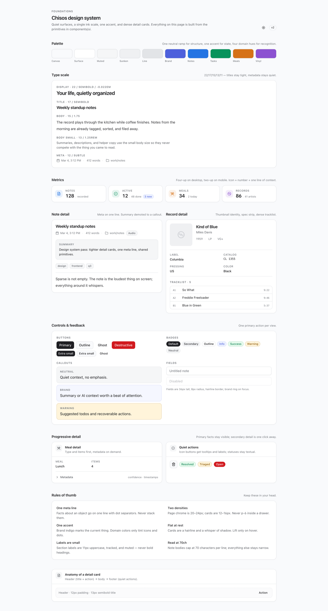
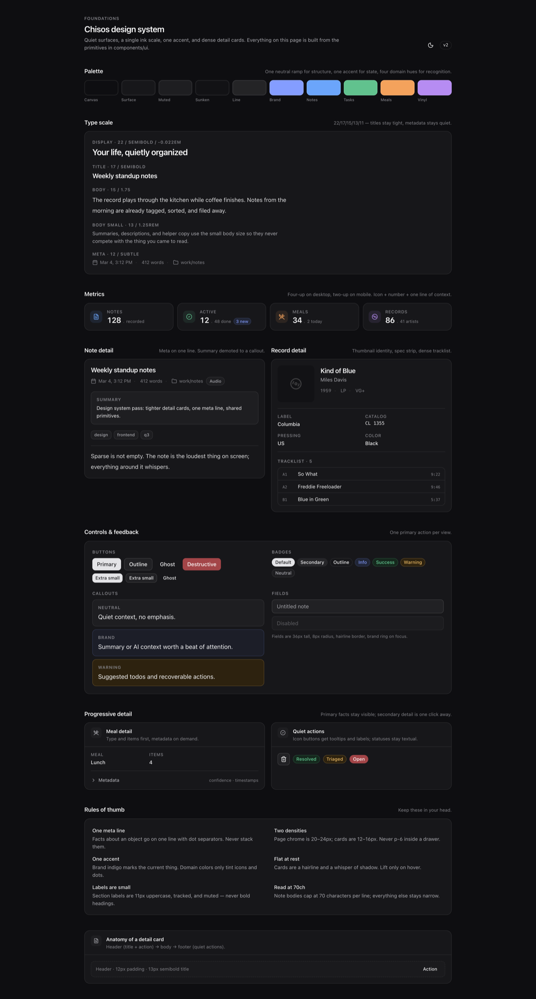
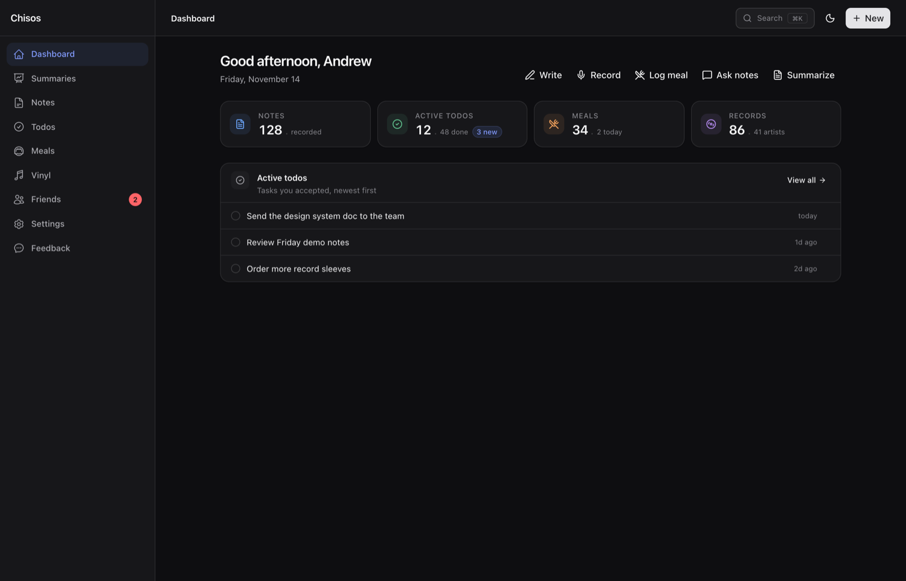
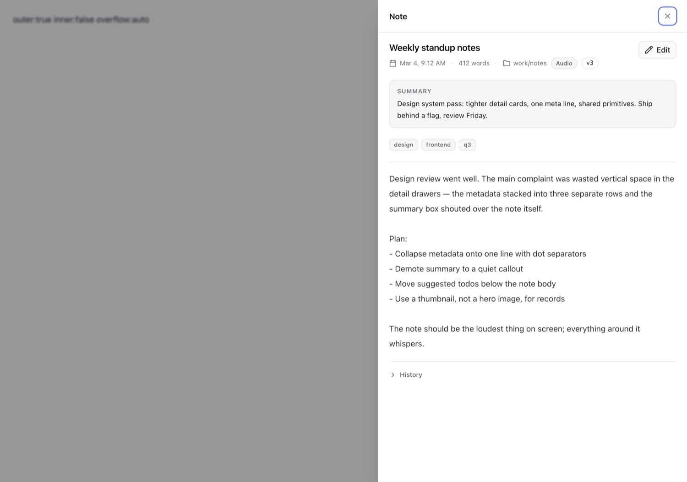

# Design System

How Chisos looks: quiet surfaces, one ink ramp, one accent, dense detail cards, and light/dark themes that follow the system preference. The system lives in two places — tokens in `frontend/src/index.css`, primitives in `frontend/src/components/ui/` — and it is previewable at **`/design`** while the dev server runs (`pnpm dev` → http://localhost:5173/design). That route is dev-only and renders "Not available" in a production bundle.





---

## Principles

1. **The content is the loudest thing on screen.** Chrome, metadata, and helper copy stay quiet.
2. **One meta line.** Facts about an object (date, length, folder, source) go on a single line with dot separators — never three stacked rows.
3. **Two densities.** Page chrome is 20–24px; cards are 12–16px. A drawer never uses `p-6`.
4. **Flat at rest, lift on hover.** Cards are a hairline border plus a whisper of shadow. Interactive cards translate up 1px and darken the border.
5. **One accent.** Brand indigo marks the current/active thing. Domain hues tint icons and dots only; they never fill cards.
6. **Read at ~70ch.** Note bodies cap at 70 characters per line. Everything else stays narrow.
7. **Details on demand.** Primary facts stay visible; revision history, meal metadata, and diagnostics live behind a `Disclosure`. Icon-only actions use `Tooltip` and always carry an accessible label.

---

## Tokens

Defined in `frontend/src/index.css` and exposed to Tailwind through `@theme inline`.

| Token | Utility | Use |
| --- | --- | --- |
| `--background` | `bg-background` | App canvas (page background) |
| `--surface` | `bg-surface` | Cards, drawers, panels |
| `--surface-muted` | `bg-surface-muted` | Nested rows, quiet callouts, hover fills |
| `--surface-sunken` | `bg-surface-sunken` | Image placeholders, skeletons |
| `--line` | `border-line` | Hairline borders and dividers |
| `--line-strong` | `border-line-strong` | Hover borders, dot separators |
| `--ink` | `text-ink` | Primary text |
| `--ink-muted` | `text-ink-muted` | Secondary text, descriptions |
| `--ink-subtle` | `text-ink-subtle` | Metadata, labels, placeholders |
| `--brand` | `text-brand` / `bg-brand` | Active nav, links, focus, current state |
| `--brand-soft` | `bg-brand-soft` | Active nav fill, selected rows |
| `--brand-solid` | `text-brand-solid` | Brand ink that must not invert (fixed white CTA) |
| `--domain-*` | `text-domain-notes` … | Notes / tasks / meals / vinyl recognition |
| `--positive` / `--positive-soft` | `text-positive` / `bg-positive-soft` | Success, completed, healthy |
| `--warning` / `--warning-soft` | `text-warning` / `bg-warning-soft` | Suggested, degraded, needs review |
| `--destructive` / `--danger-soft` | `text-destructive` / `bg-danger-soft` | Errors and destructive actions |
| `--scrim` | `bg-scrim` | Modal/drawer backdrop (fixed in both themes) |
| `--brand-foreground` | `text-brand-foreground` | Legible text on a `bg-brand` surface |

Elevation: `shadow-card` (rest), `shadow-lift` (hover), `shadow-pop` (drawers and popovers). Radius: `rounded-lg` for controls, `rounded-xl` for cards and drawers.

Type scale: 22/17/15/13/11. Section labels are 11px, uppercase, `tracking-[0.08em]`, `text-ink-subtle` — use the `.section-label` utility rather than restyling each time.

---

## Themes

`ThemeProvider` (`components/theme/ThemeProvider.tsx`) owns the choice and writes it to `localStorage` under `chisos-theme`. Three modes: `light`, `dark`, and `system` (the default, which follows `prefers-color-scheme` and updates live). `index.html` applies the saved class before first paint so a dark-mode reload never flashes light.

- Header: `ThemeToggle` — a compact dropdown shared by every app page.
- Settings: an Appearance card with the same three options, so the choice is discoverable.
- The `<html>` element gets `class="dark"` and `color-scheme: dark`; every token has a dark value, so components do not need `dark:` variants.
- Use `dark:` only for third-party surfaces you cannot tokenize.

Raw Tailwind ramps (`bg-white`, `text-gray-900`, `border-blue-200`, …) are not used in app code. When adding UI, reach for the semantic token instead — that is what keeps both themes working.



---

## Primitives

Import from `@/components/ui/detail`, `@/components/ui/page-header`, `@/components/ui/stat-card`.

### `PageHeader`

```tsx
<PageHeader
  eyebrow="Collection"
  title="Vinyl Collection"
  description="86 records · 41 artists"
  actions={<Button size="sm">Add record</Button>}
/>
```

One title treatment for every page. Actions sit on the same baseline and wrap below on narrow screens.

### `DetailCard`

A quiet card used for grouped detail content. The note drawer is the reference implementation: one meta line, a summary callout, tags, then the body at 15px/1.75.



```tsx
<DetailCard>
  <DetailCardHeader title="Active todos" subtitle="Newest first" icon={CheckCircle2} action={<Button size="xs" variant="ghost">View all</Button>} />
  <div className="border-line divide-y border-t">…</div>
</DetailCard>
```

### `DetailSection`

Label + content with the standard 8px gap. Use for tracklists, notes, audio, and history groups.

### `MetaBar` / `MetaItem`

```tsx
<MetaBar>
  <MetaItem icon={Calendar}>Mar 4, 3:12 PM</MetaItem>
  <MetaItem>412 words</MetaItem>
  <MetaItem icon={Folder}>work/notes</MetaItem>
</MetaBar>
```

Renders a wrapped line with dot separators and truncates long values. This replaces the stacked `<span>` rows that used to live in `NoteDetail`.

### `DataGrid` / `DataPoint`

Two- or three-column spec sheet for records, meals, and profile facts. Labels are 11px uppercase; values are 13px medium.

### `Callout`

`tone="neutral" | "brand" | "warning" | "danger"`. Used for summaries, search matches, and suggested todos. Replaces full-width colored boxes with a single quiet tint.

### `Disclosure`

```tsx
<Disclosure summary="History" hint="3 versions" open={showHistory} onOpenChange={setShowHistory}>
  …revision rows…
</Disclosure>
```

A quiet expandable row on a hairline. Supports uncontrolled use, controlled use (when the content is lazy-loaded, as with note revisions), and an optional hint. Use it for revision history, meal metadata, and admin diagnostics instead of another always-visible card.

### `ConfirmDialog`

```tsx
<ConfirmDialog
  open={confirmOpen}
  onOpenChange={setConfirmOpen}
  title="Move this note to Trash?"
  description="You can restore it from Trash later."
  confirmLabel="Move to Trash"
  variant="destructive"
  onConfirm={handleDelete}
/>
```

Use for destructive or irreversible actions instead of `window.confirm`. It keeps the product's tokens, works on mobile, and gives the action a clear label. Do not use it for recoverable, low-stakes actions such as pinning or archiving.

### `Tooltip`

A Radix tooltip with the app's ink-on-canvas inverted treatment. Required for icon-only buttons: pair it with `aria-label` so the control still works for keyboard and screen-reader users.

```tsx
<Tooltip>
  <TooltipTrigger asChild>
    <Button size="icon-sm" aria-label="Delete todo"><Trash2 /></Button>
  </TooltipTrigger>
  <TooltipContent>Delete todo</TooltipContent>
</Tooltip>
```

### `StatCard`

```tsx
<StatCard icon={FileText} accent="notes" label="Notes" value={128} meta="recorded" />
```

Compact metric tile: icon, label, value, optional meta and badge. Wrap in a router `Link` — the card owns its hover lift.

### `.markdown`

Long-form AI output (digests, Ask answers) uses the `.markdown` component class: 15px body, 1.75 line height, readable lists, tokenized links and code. Use it instead of `prose` — the typography plugin is not installed.

### Existing shadcn primitives

`Button`, `Badge`, `Card`, `Input`, `Textarea`, `Select`, `Tabs`, `Alert` keep the standard shadcn API. Badges add `info`, `success`, `warning`, and `neutral` tones built on the token palette.

---

## Conventions

- Prefer tokens over raw ramps. New UI should use `bg-surface`, `border-line`, `text-ink-muted` — not `bg-white`, `border-gray-200`, `text-gray-600`.
- Reuse `DetailCard` instead of a new `rounded-lg border bg-white p-4` combination.
- Metadata is a `MetaBar`, not a vertical list.
- Interactive cards use `.card-interactive` (hairline → lift) instead of bespoke hover shadows.
- Section headings are `.section-label`; page headings are `PageHeader`; card headings are 13px semibold.
- Keep icon SVGs out of feature code — use `lucide-react` icons at `size-3.5` (meta) or `size-4` (controls).
- Every color used for text should be checked against the surface: `ink-subtle` is the lightest text allowed on `surface`.

---

## Verifying changes

```bash
cd frontend
pnpm build      # tsc --noEmit + Vite build
pnpm lint       # zero-warning policy
pnpm test:run   # vitest
pnpm dev        # then open /design
```

`/design` is the visual regression surface: palette, type scale, metrics, the note and record detail patterns, controls, and the card anatomy example. Add a section there when introducing a new primitive.

---

## Known follow-ups

- Clerk-owned surfaces (sign-in, sign-up, `UserButton`) keep Clerk's own light theme. Use Clerk `appearance` bindings if that mismatch becomes distracting in dark mode.
- The `/design` chunk ships in production (tiny, renders "Not available"); move it behind a dev-only entry if the bundle budget gets tight.
- Marketing and auth pages are tokenized for both themes, but they intentionally keep the fixed `brand-gradient` CTA rather than following the surface palette.
